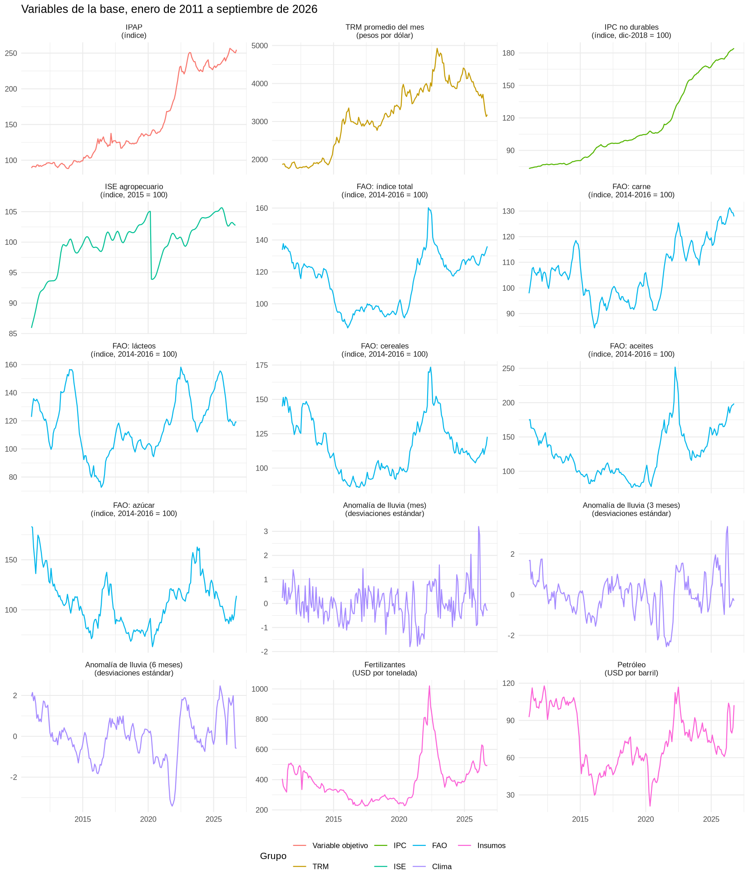

# Pronóstico del IPAP-BMC a 12 meses

**BMC DataLab Challenge · Reto B** · Bolsa Mercantil de Colombia y AFADECO

Este repositorio pronostica el **Índice de Precios Agropecuarios (IPAP)** de la Bolsa Mercantil de Colombia para los 12 meses siguientes al último dato disponible: **octubre de 2026 a septiembre de 2027**. Todo el proceso corre con un solo archivo, `main.R`: carga los datos, ajusta siete modelos, los evalúa, los combina y guarda las tablas y gráficos de resultados.

## Resultado principal

El modelo final es el **promedio simple de siete modelos** (`Promedio (todos)`).

| | Valor |
|---|---|
| MAPE de la prueba histórica (oct-2025 a sep-2026) | **0.85%** |
| MAPE de validación (16 cortes, 2021 a 2025) | 7.14% |
| Pronóstico de octubre de 2026 | **256.27** |
| Pronóstico de septiembre de 2027 | 269.33 |

> **Nota:** los resultados pueden variar un poco según la versión de los paquetes de R, sobre todo la de `xgboost`. Estas cifras se obtuvieron con R 4.4.3 y `xgboost` 3.4.2.1. Con otra versión de `xgboost` cambian los dos modelos XGBoost y los promedios que los incluyen; los demás modelos (SARIMA, ARMA, VECM y Random Forest) dan lo mismo. El detalle está en [04_documentation/REPRODUCIBILIDAD.md](04_documentation/REPRODUCIBILIDAD.md).

Las tablas completas, la comparación de los modelos y los gráficos están en **[03_outputs/RESULTADOS.md](03_outputs/RESULTADOS.md)**.

## Estructura del repositorio

```
ipap-bmc-reto-b/
├── README.md                     ← este archivo: qué es el proyecto y cómo correrlo
├── main.R                        ← corre todo el proyecto en orden (es el único que hay que abrir)
├── ipap-bmc-reto-b.Rproj         ← proyecto de RStudio (fija la carpeta de trabajo)
├── 01_data/
│   └── IPAP_De_completa.xlsx     ← base mensual, ene-2011 a sep-2026
├── 02_code/
│   ├── setup.R                   ← revisa R, la carpeta de trabajo y los paquetes, e instala los que falten
│   ├── descriptivas.R            ← estadísticas descriptivas y gráficos de las variables
│   └── ipap_concurso_final.R     ← el modelo: validación, prueba histórica y pronóstico
├── 03_outputs/
│   ├── RESULTADOS.md             ← resumen de los resultados: tablas, pronóstico y gráficos
│   ├── *.csv, *.png              ← lo que genera el modelo (18 tablas y 5 gráficos)
│   ├── salida_consola.txt        ← lo que imprimió la consola en la corrida publicada
│   └── descriptivas/             ← lo que genera descriptivas.R
├── 04_documentation/
│   ├── DATOS.md                  ← diccionario de variables, fuentes y estadísticas descriptivas
│   ├── REPRODUCIBILIDAD.md       ← versiones, tiempos, semillas y cómo verificar los resultados
│   └── REFERENCIAS.md            ← bibliografía, fuentes de datos y software
├── .gitignore                    ← archivos que no se suben a GitHub
└── .gitattributes                ← finales de línea consistentes entre sistemas operativos
```

## Los datos

Una base mensual de **189 meses (enero de 2011 a septiembre de 2026)** con el IPAP y 14 variables explicativas agrupadas así:

| Grupo | Variables | Fuente |
|---|---|---|
| Variable objetivo | IPAP | Bolsa Mercantil de Colombia |
| Tasa de cambio | TRM promedio del mes | Banco de la República |
| Precios al consumidor | IPC de bienes no durables | DANE |
| Actividad agropecuaria | ISE agropecuario | DANE |
| Precios internacionales de alimentos | Índice FAO y subíndices de carne, lácteos, cereales, aceites y azúcar | FAO |
| Clima | Anomalía de lluvia del mes y acumulada a 3 y 6 meses (20 departamentos, ponderada por su peso en el IPAP) | NASA POWER |
| Insumos | Fertilizantes (USD por tonelada) y petróleo (USD por barril) | Banco Mundial, Pink Sheet |

El diccionario completo, las unidades, las estadísticas descriptivas y cómo entra cada variable a los modelos están en **[04_documentation/DATOS.md](04_documentation/DATOS.md)**. Las estadísticas y los gráficos de cada variable los genera el script [`02_code/descriptivas.R`](02_code/descriptivas.R), que es independiente del modelo y tarda unos segundos.



También se probaron el ONI (El Niño y La Niña) y el IPP agropecuario, pero se quitaron porque no mejoraban el pronóstico.

## Qué hace el código

El script del modelo, [`02_code/ipap_concurso_final.R`](02_code/ipap_concurso_final.R), está dividido en pasos numerados. Cada paso explica en comentarios su teoría y su criterio.

| Paso | Qué hace |
|---|---|
| 0 | Instala (si faltan) y carga los paquetes |
| 1 | Parámetros: horizonte, cortes de validación, rejillas de hiperparámetros, exógenas y rezagos de publicación |
| 2 | Carga la base, revisa que esté completa y la parte en entrenamiento (ene-2011 a sep-2025) y prueba (oct-2025 a sep-2026) |
| 3 | Orden de integración de las series (Dickey-Fuller aumentada) |
| 4 | Métricas de error: MAPE y RMSE |
| 5 | Modelos autorregresivos: SARIMA automático, ARMA(2,2)+SAR(1) y VECM de Johansen (IPAP e IPC) |
| 6 | Pruebas de supuestos sobre los residuos |
| 7 | Modelos de machine learning: Random Forest y XGBoost, con y sin exógenas |
| 8 | Validación interna con 16 cortes móviles |
| 9 | Ajuste de hiperparámetros con el MAPE de validación |
| 10 | Ablación: qué grupo de exógenas aporta y cuál sobra |
| 11 | Evaluación de los siete modelos y de los promedios |
| 11b | Comparación del modelo final con el mejor modelo de machine learning |
| 12 | Tablas de entrega: prueba histórica y pronóstico a 12 meses |
| 13 | Importancia de las variables |
| 14 | Gráficos |

### Los siete modelos

| # | Modelo | Tipo | Qué usa |
|---|---|---|---|
| 1 | SARIMA automático | Autorregresivo | Solo el IPAP (en logaritmos) |
| 2 | ARMA(2,2) + SAR(1) | Autorregresivo | Crecimiento mensual del IPAP |
| 3 | VECM de Johansen | Autorregresivo | IPAP e IPC de no durables (cointegrados) |
| 4 | Random Forest | Machine learning | Historia del IPAP |
| 5 | Random Forest + exógenas | Machine learning | Historia del IPAP y las 14 variables |
| 6 | XGBoost | Machine learning | Historia del IPAP |
| 7 | XGBoost + exógenas | Machine learning | Historia del IPAP y las 14 variables |

El **modelo final** es el promedio simple de los siete pronósticos. Promediar modelos con supuestos distintos compensa en parte sus errores (Bates y Granger, 1969; Timmermann, 2006).

### Cómo se evalúa

- **Prueba histórica (la del reto).** Se entrena con datos hasta septiembre de 2025 y se pronostican de una vez los 12 meses de octubre de 2025 a septiembre de 2026. El MAPE se calcula sobre el nivel del IPAP.
- **Validación interna.** Se usa para escoger hiperparámetros, variables y modelo, **nunca la prueba**. Hay 16 cortes dentro del entrenamiento, separados 3 meses (de diciembre de 2020 a septiembre de 2024). En cada corte el modelo se entrena solo con datos hasta ese mes y pronostica los 12 siguientes. El MAPE de validación es el promedio de los 16.
- **Pronóstico final.** Se reentrena con toda la muestra y se pronostican octubre de 2026 a septiembre de 2027.
- **Sin información del futuro.** Cada variable entra con su rezago de publicación, y el código verifica que ningún atributo use datos posteriores al mes del pronóstico.

## Cómo correrlo

### Qué se necesita

- **R 4.3 o más reciente** ([descargar](https://cran.r-project.org/)). Es lo que piden las versiones actuales de `xgboost`.
- **RStudio** (recomendado, no obligatorio) ([descargar](https://posit.co/download/rstudio-desktop/)).
- Conexión a internet la primera vez, para instalar los paquetes.
- Paquetes de R: `readxl`, `ggplot2`, `forecast`, `urca`, `vars`, `lmtest`, `tseries`, `ranger` y `xgboost`. **`02_code/setup.R` los instala solo si faltan** y muestra qué versión quedó instalada frente a la que se usó.

Las versiones exactas con las que se generaron los resultados están en [04_documentation/REPRODUCIBILIDAD.md](04_documentation/REPRODUCIBILIDAD.md).

### Pasos

1. **Descargar el repositorio.** En GitHub: botón verde **Code → Download ZIP**, y descomprimir. O con git:
   ```bash
   git clone <URL-del-repositorio>
   ```
2. **Abrir el proyecto.** Doble clic en `ipap-bmc-reto-b.Rproj`. RStudio se abre con la carpeta del repositorio como carpeta de trabajo, así que la ruta `01_data/IPAP_De_completa.xlsx` funciona sin cambiar nada.
3. **Abrir `main.R` y correrlo completo**, con el botón **Source** o con `Ctrl + Shift + S` (`Cmd + Shift + S` en Mac). `main.R` corre, en orden:

   | Orden | Script | Qué hace | Tiempo |
   |---|---|---|---|
   | 1 | `02_code/setup.R` | Revisa la versión de R y la carpeta de trabajo, instala los paquetes que falten y muestra sus versiones | segundos (más la instalación, la primera vez) |
   | 2 | `02_code/descriptivas.R` | Estadísticas descriptivas y gráficos de las variables | segundos |
   | 3 | `02_code/ipap_concurso_final.R` | El modelo completo | alrededor de 1 hora y 45 minutos |

Sin RStudio, desde una terminal ubicada en la carpeta del repositorio:

```bash
Rscript main.R
```

Cada script también se puede correr por separado; da los mismos resultados. Por ejemplo, para ver solo las estadísticas descriptivas basta con correr `02_code/descriptivas.R`.

> **Importante:** los scripts usan rutas relativas a la **carpeta principal** del repositorio (la que tiene `main.R`), no a `02_code/`. Si no se abre con el `.Rproj`, hay que fijar antes esa carpeta como carpeta de trabajo, con `setwd("ruta/a/ipap-bmc-reto-b")` o abriendo `main.R` y usando *Session → Set Working Directory → To Source File Location*.

### Cuánto tarda

La corrida completa del modelo tardó **1 hora y 44 minutos** en un computador de 2 núcleos. La mayor parte del tiempo se va en la búsqueda de hiperparámetros de los modelos de machine learning con 16 cortes de validación. Para una prueba rápida, en el PASO 1 se puede poner:

```r
NVAL         <- 8      # en vez de 16
ARIMA_RAPIDO <- TRUE   # búsqueda más corta del SARIMA
```

Con esos cambios los resultados **no** son los oficiales; sirven solo para revisar que todo corre.

### Qué produce

- **En la consola:** pruebas de raíz unitaria, cointegración, supuestos, el ajuste de hiperparámetros, la ablación, la tabla comparativa de modelos, la prueba histórica y el pronóstico.
- **En la carpeta `03_outputs/`:** 18 tablas CSV y 5 gráficos PNG. Además, el repositorio incluye `salida_consola.txt`, la copia de lo que imprimió la consola en la corrida publicada. Cada archivo está explicado en [03_outputs/RESULTADOS.md](03_outputs/RESULTADOS.md#archivos-de-esta-carpeta).
- **En la carpeta `03_outputs/descriptivas/`** (la genera `02_code/descriptivas.R`): la tabla de estadísticas descriptivas y dos gráficos, el IPAP y las 15 variables.

## Reproducibilidad

- **Semilla fija** (`SEED <- 2026`) para Random Forest y XGBoost: dos corridas en el mismo computador, con las mismas versiones de los paquetes, dan los mismos números.
- **Versiones de los paquetes:** `02_code/setup.R` muestra las versiones instaladas frente a las usadas. Si la de `xgboost` es distinta, los resultados de XGBoost y de los promedios pueden variar.
- **Una sola fuente de datos** dentro del repositorio y **rutas relativas**: no hay que cambiar ninguna ruta.
- **Validación sin fuga de información** y elección del modelo sin mirar la prueba.
- **Revisión de la base** al cargarla: el código se detiene si faltan columnas, si hay meses repetidos o faltantes, o si hay datos vacíos donde no deberían.

Los detalles (versiones de R y de los paquetes, qué puede cambiar entre computadores y cómo comprobar que la corrida coincide) están en **[04_documentation/REPRODUCIBILIDAD.md](04_documentation/REPRODUCIBILIDAD.md)**.

## Limitaciones

- La prueba histórica es un solo año. Por eso las decisiones se toman con la validación de 16 cortes, que incluye años difíciles como el giro de precios de 2023.
- Las ventanas de validación se traslapan, así que la información independiente equivale a pocos años.
- Los errores de los modelos son mucho mayores en los cortes de 2021 a 2023, con los choques de precios de la pospandemia. Un choque parecido en el horizonte de pronóstico aumentaría el error.
- Algunas fuentes revisan sus datos (por ejemplo, los datos recientes de carne de la FAO), así que actualizar la base puede cambiar un poco los resultados.

## Referencias

La lista completa, con las fuentes de datos y el software, está en **[04_documentation/REFERENCIAS.md](04_documentation/REFERENCIAS.md)**. Las principales:

- Bates, J. M. y Granger, C. W. J. (1969). The combination of forecasts. *Operational Research Quarterly*, 20(4), 451-468.
- Breiman, L. (2001). Random forests. *Machine Learning*, 45(1), 5-32.
- Chen, T. y Guestrin, C. (2016). XGBoost: a scalable tree boosting system. *Proceedings of the 22nd ACM SIGKDD*, 785-794.
- Hyndman, R. J. y Khandakar, Y. (2008). Automatic time series forecasting: the forecast package for R. *Journal of Statistical Software*, 27(3), 1-22.
- Johansen, S. (1991). Estimation and hypothesis testing of cointegration vectors in Gaussian vector autoregressive models. *Econometrica*, 59(6), 1551-1580.
- Timmermann, A. (2006). Forecast combinations. En *Handbook of Economic Forecasting*, vol. 1, cap. 4, 135-196.

## Equipo

- Juan Camilo Jules Oviedo
- Angel Esteban Bonilla Escamilla
- David Steven Parra Almeida
