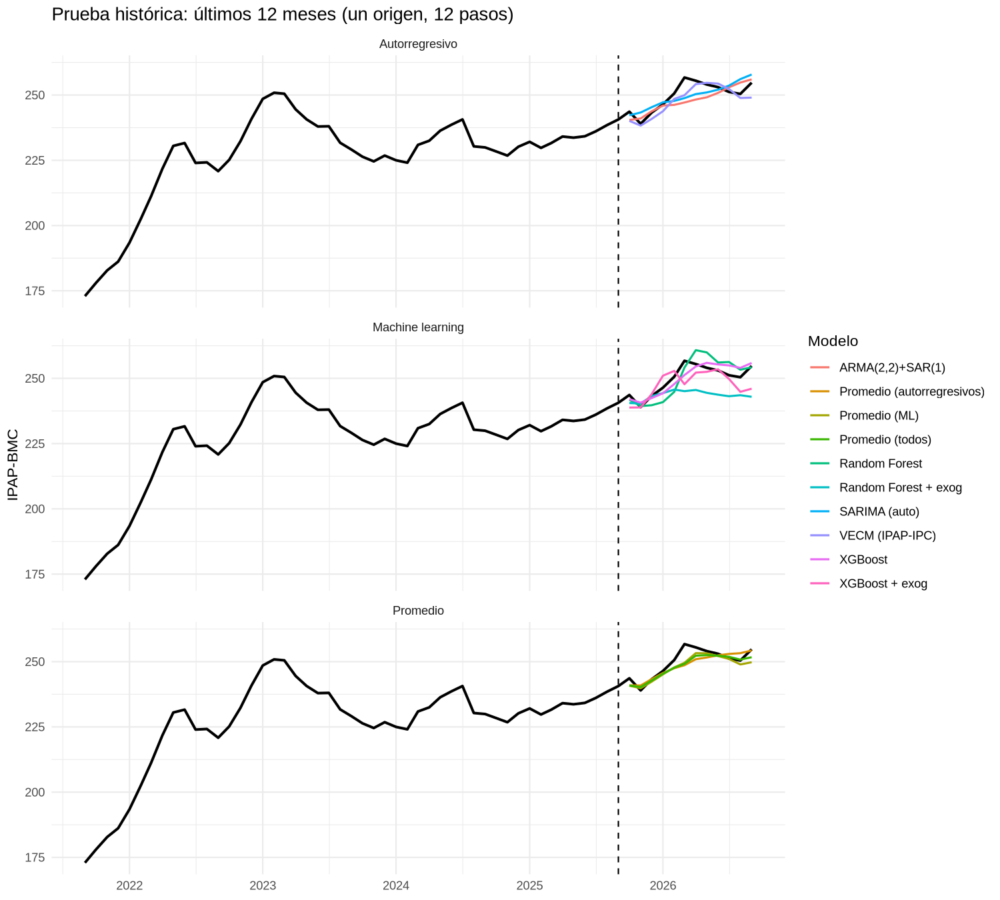
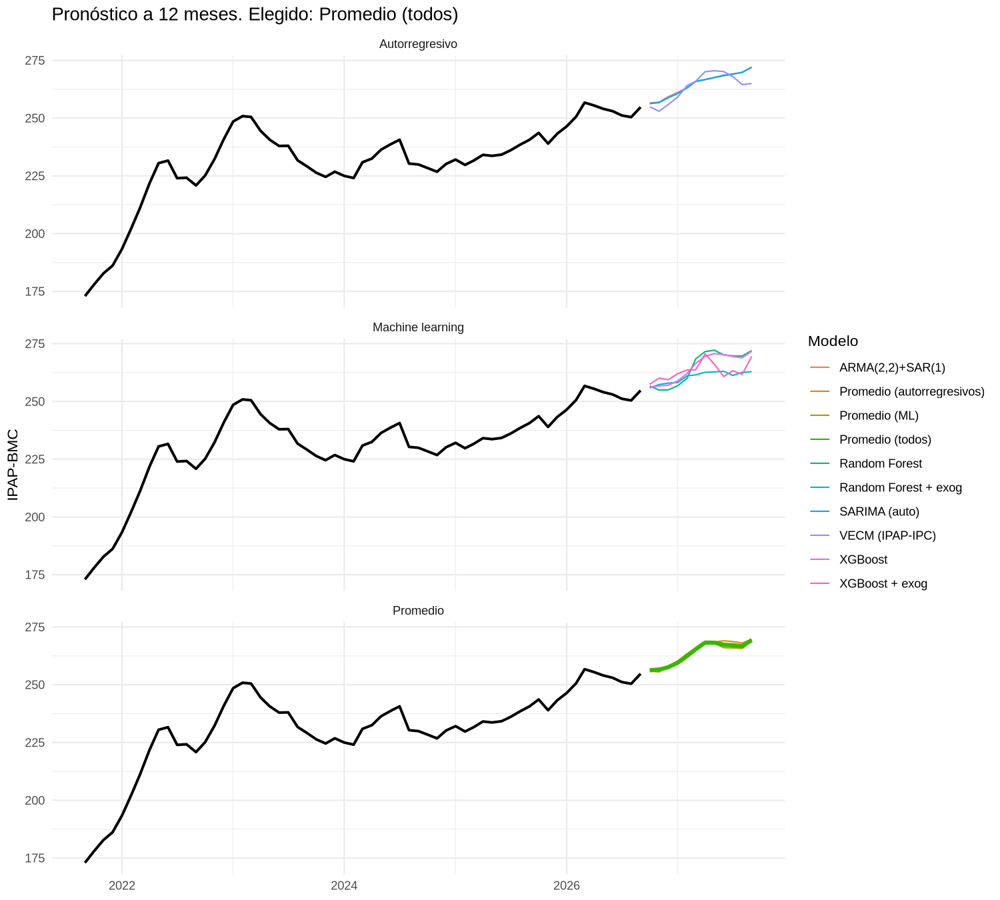
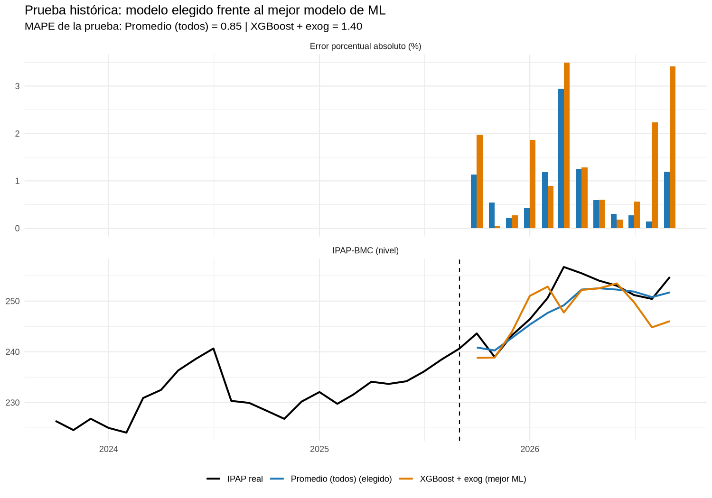
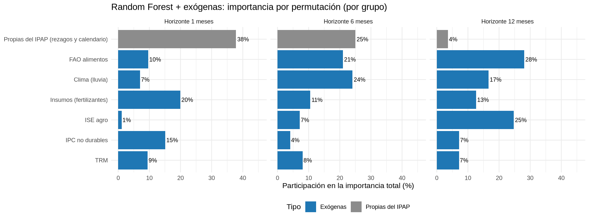
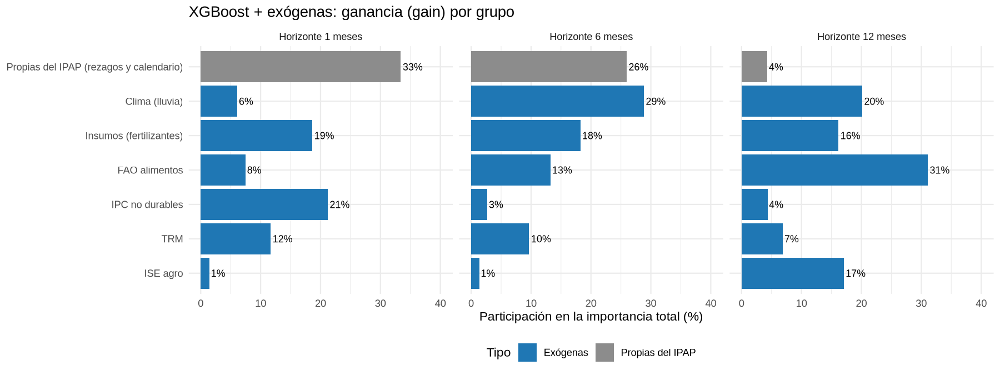

# Resultados

Este documento resume lo que produce [`ipap_concurso_final.R`](ipap_concurso_final.R). Todas las cifras salen de los archivos de la carpeta [`resultados/`](resultados/), generados con la base [`datos/IPAP_De_completa.xlsx`](datos/IPAP_De_completa.xlsx) (enero de 2011 a septiembre de 2026) y con el entorno descrito en [docs/REPRODUCIBILIDAD.md](docs/REPRODUCIBILIDAD.md).

**Cómo leer el MAPE.** Es el error porcentual absoluto medio: en promedio, cuánto se aleja el pronóstico del IPAP real, en porcentaje. Un MAPE de 0.85 quiere decir que, en promedio, el pronóstico se equivocó en 0.85% del valor del índice.

## Contenido

1. [Resumen](#1-resumen)
2. [Comparación de los modelos](#2-comparación-de-los-modelos)
3. [Prueba histórica: octubre de 2025 a septiembre de 2026](#3-prueba-histórica-octubre-de-2025-a-septiembre-de-2026)
4. [Pronóstico: octubre de 2026 a septiembre de 2027](#4-pronóstico-octubre-de-2026-a-septiembre-de-2027)
5. [Validación interna por corte](#5-validación-interna-por-corte)
6. [Modelo final frente al mejor modelo de machine learning](#6-modelo-final-frente-al-mejor-modelo-de-machine-learning)
7. [Variables exógenas: aporte e importancia](#7-variables-exógenas-aporte-e-importancia)
8. [Pruebas econométricas](#8-pruebas-econométricas)
9. [Archivos de la carpeta resultados](#archivos-de-la-carpeta-resultados)

## 1. Resumen

| | Valor |
|---|---|
| Modelo final | Promedio simple de los siete modelos, `Promedio (todos)` |
| MAPE de la prueba histórica (oct-2025 a sep-2026) | **0.85%** |
| RMSE de la prueba histórica | 2.88 puntos del índice |
| MAPE de validación (promedio de 16 cortes) | 7.14% |
| Último dato observado (septiembre de 2026) | 254.74 |
| Pronóstico de octubre de 2026 | **256.27** |
| Pronóstico de septiembre de 2027 | 269.33 (5.7% por encima de septiembre de 2026) |

- En la prueba histórica, el promedio de los siete modelos tiene el menor MAPE (0.85%) y es más preciso que cualquiera de los modelos por separado. El mejor modelo individual fue XGBoost sin exógenas (0.94%).
- En la validación, el modelo con menor MAPE es XGBoost con exógenas (6.75%), pero en la prueba su MAPE sube a 1.40%. El promedio es más estable: en la prueba tuvo menos error que XGBoost con exógenas en 9 de los 12 meses.
- El pronóstico prevé que el IPAP suba de forma gradual hasta abril de 2027 (268.24), se mantenga casi estable hasta agosto y cierre septiembre de 2027 en 269.33.

## 2. Comparación de los modelos

Archivo: [`resultados/tabla_comparacion_modelos.csv`](resultados/tabla_comparacion_modelos.csv). Ordenada de menor a mayor MAPE de prueba.

| Modelo | Tipo | Exógenas | MAPE validación (%) | MAPE prueba (%) | RMSE prueba | Especificación elegida |
|---|---|---|---:|---:|---:|---|
| **Promedio (todos)** ← modelo final | Promedio | Mixto | 7.14 | **0.85** | 2.88 | Los 7 modelos |
| Promedio (ML) | Promedio | Mixto | 7.03 | 0.87 | 2.94 | RF, RF + exog, XGBoost, XGBoost + exog |
| XGBoost | Machine learning | No | 7.70 | 0.94 | 2.69 | L=6, profundidad 1, eta 0.05, 50 rondas |
| Promedio (autorregresivos) | Promedio | Mixto | 7.56 | 0.97 | 3.22 | SARIMA, ARMA, VECM |
| VECM (IPAP-IPC) | Autorregresivo | Sí (IPC) | 8.44 | 0.99 | 3.12 | Johansen, K=2, r=1 |
| SARIMA (auto) | Autorregresivo | No | 7.35 | 1.32 | 3.88 | ARIMA(0,1,2)(0,0,1)[12] con deriva |
| ARMA(2,2)+SAR(1) | Autorregresivo | No | 7.20 | 1.38 | 4.38 | ARMA(2,2) + SAR(1)[12] sobre el crecimiento |
| XGBoost + exog (mejor ML) | Machine learning | Sí | 6.75 | 1.40 | 4.59 | L=6, LX=6, profundidad 1, eta 0.05, 800 rondas |
| Random Forest | Machine learning | No | 7.98 | 1.41 | 4.02 | L=12, mtry=100%, hoja mínima 20 |
| Random Forest + exog | Machine learning | Sí | 6.88 | 2.59 | 7.66 | L=3, LX=6, mtry=100%, hoja mínima 5, Extra Trees |

**Cómo se lee:**

- **MAPE de validación:** promedio de 16 cortes dentro del entrenamiento (de diciembre de 2020 a septiembre de 2024). Es el criterio para escoger hiperparámetros y variables. No usa la prueba.
- **MAPE de prueba:** un solo pronóstico de 12 meses hecho desde septiembre de 2025, comparado con lo que pasó de octubre de 2025 a septiembre de 2026. Es la prueba que pide el reto.
- **L** es el número de rezagos del crecimiento del IPAP; **LX**, el de las exógenas de precios (TRM, IPC, fertilizantes). Las especificaciones de los modelos de ML son las que ganaron la búsqueda de hiperparámetros por MAPE de validación (archivos `grilla_*.csv`).
- **Modelo final.** El promedio de los siete se fijó como modelo final en el código (`MODELO_FINAL`, PASO 1), sin escogerlo por su resultado en la prueba. El promedio de los modelos de ML tiene un MAPE de validación un poco menor (7.03 frente a 7.14), pero deja por fuera a los modelos autorregresivos. Los modelos autorregresivos aportan una forma distinta de equivocarse, que es lo que hace útil promediar (Bates y Granger, 1969; Timmermann, 2006).
- Los MAPE de validación son mucho más altos que los de prueba porque la validación incluye los años 2021 a 2023, con los choques de precios de la pospandemia (sección 5).

## 3. Prueba histórica: octubre de 2025 a septiembre de 2026

Archivo: [`resultados/prueba_historica_elegido.csv`](resultados/prueba_historica_elegido.csv). Los modelos se entrenan solo con datos hasta septiembre de 2025 y pronostican los 12 meses siguientes de una vez.

| Mes | IPAP real | IPAP pronosticado | Error absoluto (%) |
|---|---:|---:|---:|
| 2025-10 | 243.62 | 240.85 | 1.14 |
| 2025-11 | 238.98 | 240.27 | 0.54 |
| 2025-12 | 243.25 | 242.75 | 0.21 |
| 2026-01 | 246.42 | 245.36 | 0.43 |
| 2026-02 | 250.62 | 247.67 | 1.18 |
| 2026-03 | 256.72 | 249.16 | 2.94 |
| 2026-04 | 255.47 | 252.27 | 1.25 |
| 2026-05 | 254.03 | 252.52 | 0.60 |
| 2026-06 | 253.02 | 252.27 | 0.30 |
| 2026-07 | 251.18 | 251.86 | 0.27 |
| 2026-08 | 250.43 | 250.78 | 0.14 |
| 2026-09 | 254.74 | 251.71 | 1.19 |
| **MAPE** | | | **0.85** |

El mayor error es el de marzo de 2026 (2.94%), cuando el IPAP llegó a su máximo histórico (256.72) y todos los modelos se quedaron cortos.

**Pronóstico de cada modelo en la prueba** ([`resultados/prueba_historica_todos.csv`](resultados/prueba_historica_todos.csv)):

| Mes | Real | SARIMA | ARMA | VECM | RF | RF + exog | XGBoost | XGBoost + exog |
|---|---:|---:|---:|---:|---:|---:|---:|---:|
| 2025-10 | 243.6 | 242.3 | 240.4 | 240.1 | 241.8 | 240.5 | 242.0 | 238.8 |
| 2025-11 | 239.0 | 243.3 | 241.0 | 238.3 | 239.4 | 240.4 | 240.7 | 238.9 |
| 2025-12 | 243.3 | 245.3 | 243.8 | 240.8 | 239.7 | 243.2 | 242.4 | 243.9 |
| 2026-01 | 246.4 | 247.2 | 246.0 | 243.8 | 240.9 | 244.3 | 244.3 | 251.0 |
| 2026-02 | 250.6 | 247.7 | 246.2 | 248.5 | 244.8 | 245.7 | 247.8 | 252.9 |
| 2026-03 | 256.7 | 248.8 | 247.1 | 249.9 | 254.1 | 245.1 | 251.3 | 247.7 |
| 2026-04 | 255.5 | 250.4 | 248.3 | 254.2 | 260.8 | 245.5 | 254.6 | 252.2 |
| 2026-05 | 254.0 | 251.0 | 249.1 | 254.7 | 259.9 | 244.4 | 255.9 | 252.5 |
| 2026-06 | 253.0 | 252.0 | 250.8 | 254.4 | 256.1 | 243.7 | 255.3 | 253.5 |
| 2026-07 | 251.2 | 253.6 | 253.0 | 252.3 | 256.3 | 243.1 | 255.0 | 249.8 |
| 2026-08 | 250.4 | 256.1 | 254.8 | 248.9 | 253.3 | 243.5 | 254.0 | 244.8 |
| 2026-09 | 254.7 | 257.9 | 256.0 | 249.0 | 254.2 | 242.9 | 255.9 | 246.0 |

Algunos modelos se quedan cortos y otros se pasan en los mismos meses. Por ejemplo, en abril de 2026 el SARIMA pronosticó 250.4 y el Random Forest 260.8, frente a un real de 255.5. Por eso el promedio tiene menos error que cada modelo por separado.

## 4. Pronóstico: octubre de 2026 a septiembre de 2027

Archivo: [`resultados/pronostico_12m_elegido.csv`](resultados/pronostico_12m_elegido.csv). Los modelos se reentrenan con toda la muestra (hasta septiembre de 2026).

| Mes | IPAP pronosticado | Variación frente a sep-2026 (%) |
|---|---:|---:|
| 2026-10 | 256.27 | 0.60 |
| 2026-11 | 256.53 | 0.70 |
| 2026-12 | 257.62 | 1.13 |
| 2027-01 | 259.54 | 1.88 |
| 2027-02 | 262.47 | 3.03 |
| 2027-03 | 265.39 | 4.18 |
| 2027-04 | 268.24 | 5.30 |
| 2027-05 | 268.21 | 5.29 |
| 2027-06 | 267.33 | 4.94 |
| 2027-07 | 267.11 | 4.85 |
| 2027-08 | 266.72 | 4.70 |
| 2027-09 | 269.33 | 5.73 |

**Pronóstico de cada modelo** ([`resultados/pronostico_12m_todos.csv`](resultados/pronostico_12m_todos.csv)):

| Mes | SARIMA | ARMA | VECM | RF | RF + exog | XGBoost | XGBoost + exog |
|---|---:|---:|---:|---:|---:|---:|---:|
| 2026-10 | 256.3 | 256.6 | 254.9 | 256.7 | 255.8 | 256.2 | 257.4 |
| 2026-11 | 256.7 | 256.9 | 253.0 | 254.9 | 257.3 | 256.7 | 260.1 |
| 2026-12 | 258.8 | 259.3 | 255.9 | 255.0 | 257.9 | 257.0 | 259.4 |
| 2027-01 | 260.6 | 261.1 | 259.1 | 256.8 | 258.2 | 258.9 | 262.0 |
| 2027-02 | 263.1 | 263.2 | 264.1 | 260.1 | 261.1 | 262.1 | 263.6 |
| 2027-03 | 266.0 | 265.8 | 265.9 | 268.4 | 261.5 | 266.4 | 263.7 |
| 2027-04 | 266.7 | 266.6 | 270.1 | 271.6 | 262.6 | 269.5 | 270.6 |
| 2027-05 | 267.6 | 267.4 | 270.5 | 272.2 | 262.8 | 270.7 | 266.2 |
| 2027-06 | 268.6 | 268.3 | 270.2 | 270.2 | 263.0 | 270.3 | 260.8 |
| 2027-07 | 269.1 | 268.9 | 268.0 | 269.7 | 261.2 | 269.4 | 263.3 |
| 2027-08 | 269.8 | 269.9 | 264.5 | 269.7 | 262.6 | 268.9 | 261.7 |
| 2027-09 | 272.0 | 272.1 | 265.0 | 272.0 | 262.9 | 271.8 | 269.5 |

Los siete modelos coinciden en que el IPAP sube en el próximo año. Para septiembre de 2027 los pronósticos van de 262.9 (Random Forest con exógenas) a 272.1 (ARMA).

## 5. Validación interna por corte

Archivo: [`resultados/mape_por_origen.csv`](resultados/mape_por_origen.csv). Cada fila es un pronóstico de 12 meses hecho desde un corte distinto, usando solo los datos disponibles hasta ese corte. Por ejemplo, la fila "2024-09 a 2025-09" entrena hasta septiembre de 2024 y pronostica de octubre de 2024 a septiembre de 2025. La última fila es la prueba histórica.

| Corte a fin del pronóstico | SARIMA | ARMA | VECM | RF | RF + exog | XGBoost | XGBoost + exog | Promedio (todos) |
|---|---:|---:|---:|---:|---:|---:|---:|---:|
| 2024-09 a 2025-09 | 0.92 | 0.93 | 1.73 | 2.42 | 1.50 | 2.50 | 0.95 | 1.43 |
| 2024-06 a 2025-06 | 5.81 | 5.40 | 4.66 | 4.51 | 2.97 | 5.23 | 1.52 | 4.22 |
| 2024-03 a 2025-03 | 2.01 | 1.94 | 1.26 | 1.87 | 1.42 | 2.76 | 1.30 | 1.61 |
| 2023-12 a 2024-12 | 1.80 | 1.97 | 2.57 | 2.73 | 1.43 | 2.62 | 3.00 | 1.61 |
| 2023-09 a 2024-09 | 3.00 | 3.95 | 5.40 | 3.51 | 1.34 | 3.38 | 3.09 | 2.61 |
| 2023-06 a 2024-06 | 6.21 | 7.15 | 6.21 | 8.46 | 4.97 | 5.93 | 3.91 | 5.81 |
| 2023-03 a 2024-03 | 14.05 | 14.82 | 17.82 | 16.01 | 11.39 | 14.25 | 9.20 | 13.94 |
| 2022-12 a 2023-12 | 10.10 | 11.73 | 19.78 | 13.21 | 5.46 | 9.77 | 4.02 | 10.25 |
| 2022-09 a 2023-09 | 4.28 | 4.66 | 6.97 | 2.90 | 5.70 | 3.87 | 5.73 | 4.08 |
| 2022-06 a 2023-06 | 12.72 | 6.61 | 13.03 | 8.01 | 3.69 | 5.57 | 5.24 | 7.12 |
| 2022-03 a 2023-03 | 2.54 | 2.30 | 4.33 | 4.66 | 6.90 | 5.94 | 6.97 | 3.64 |
| 2021-12 a 2022-12 | 9.50 | 9.68 | 3.77 | 11.35 | 11.82 | 12.20 | 9.60 | 9.67 |
| 2021-09 a 2022-09 | 11.52 | 11.93 | 11.35 | 14.73 | 14.39 | 15.02 | 15.03 | 13.42 |
| 2021-06 a 2022-06 | 9.68 | 9.49 | 13.26 | 12.79 | 12.57 | 12.58 | 14.07 | 11.98 |
| 2021-03 a 2022-03 | 11.90 | 11.54 | 12.76 | 11.52 | 14.03 | 11.99 | 15.38 | 12.73 |
| 2020-12 a 2021-12 | 11.59 | 11.08 | 10.15 | 9.02 | 10.44 | 9.61 | 8.91 | 10.07 |
| **Prueba 2025-10 a 2026-09** | 1.32 | 1.38 | 0.99 | 1.41 | 2.59 | 0.94 | 1.40 | **0.85** |

- Los errores grandes se concentran en los cortes de diciembre de 2020 a junio de 2023, cuyos pronósticos cubren el alza de precios de 2021-2022 y el giro de 2023. Desde el corte de septiembre de 2023 en adelante, ningún modelo pasa de 6%.
- Ningún modelo gana en todos los cortes, y el modelo que gana cambia de un corte a otro. Por eso se usa el promedio de varios modelos y no uno solo.

## 6. Modelo final frente al mejor modelo de machine learning

Archivos: [`resultados/comparacion_elegido_vs_mejor_ml.csv`](resultados/comparacion_elegido_vs_mejor_ml.csv), [`resultados/mape_por_origen_elegido_vs_mejor_ml.csv`](resultados/mape_por_origen_elegido_vs_mejor_ml.csv) y [`resultados/prueba_historica_elegido_vs_mejor_ml.csv`](resultados/prueba_historica_elegido_vs_mejor_ml.csv).

El mejor modelo de ML es el de menor MAPE de validación entre los cuatro: XGBoost con exógenas.

| Modelo | MAPE validación (%) | MAPE prueba (%) | RMSE prueba | Cortes de validación con menor error (de 16) |
|---|---:|---:|---:|---:|
| Promedio (todos) | 7.14 | **0.85** | **2.88** | 7 |
| XGBoost + exog | **6.75** | 1.40 | 4.59 | 9 |

- En la validación, XGBoost con exógenas tiene menos error en 9 de los 16 cortes y un MAPE promedio 0.39 puntos menor.
- En la prueba, el promedio tiene menos error en 9 de los 12 meses, y su MAPE es 0.55 puntos menor.
- El promedio no depende de que un solo modelo acierte. Con una diferencia pequeña en la validación y un resultado mejor en la prueba, se prefiere el promedio por ser más estable.

## 7. Variables exógenas: aporte e importancia

### Efecto de agregar las exógenas

Archivo: [`resultados/efecto_exogenas.csv`](resultados/efecto_exogenas.csv).

| Modelo | Validación sin exógenas | Validación con exógenas | Prueba sin exógenas | Prueba con exógenas |
|---|---:|---:|---:|---:|
| Random Forest | 7.98 | 6.88 | 1.41 | 2.59 |
| XGBoost | 7.70 | 6.75 | 0.94 | 1.40 |

Con exógenas, el MAPE de validación baja alrededor de un punto en los dos modelos. En la prueba pasa lo contrario: los modelos sin exógenas tienen menos error. Como la prueba es un solo año, las exógenas se conservan por su mejora en los 16 cortes de validación. Además, el modelo final promedia las versiones con y sin exógenas.

### Ablación por grupos (Random Forest con exógenas)

Archivo: [`resultados/ablacion_grupos_exog.csv`](resultados/ablacion_grupos_exog.csv). Se quita un grupo a la vez y se vuelve a calcular el MAPE de validación. Un cambio positivo quiere decir que el MAPE empeora sin ese grupo, o sea que el grupo aporta.

| Escenario | MAPE validación (%) | Cambio frente a la base |
|---|---:|---:|
| Base (los seis grupos) | 6.88 | 0.00 |
| Sin TRM | 7.08 | +0.20 |
| Sin IPC | 6.92 | +0.04 |
| Sin ISE | 6.61 | −0.26 |
| Sin FAO | 6.63 | −0.24 |
| Sin clima | 7.23 | +0.36 |
| Sin insumos | 7.14 | +0.27 |
| Sin ninguna exógena | 8.18 | +1.30 |

- Los grupos que más aportan en la validación son el clima (+0.36), los insumos (+0.27) y la TRM (+0.20).
- Quitar el ISE o la FAO baja un poco el MAPE de validación. Aun así, se conservan por las razones del PASO 1 del código: en una prueba retrospectiva sobre cuatro cortes, quitar el ISE empeoró el pronóstico del Random Forest, y los dos grupos son de los más importantes a 12 meses (ver la tabla siguiente).
- Sin ninguna exógena, el MAPE sube 1.30 puntos.

### Importancia por grupo

Archivo: [`resultados/importancia_por_grupo.csv`](resultados/importancia_por_grupo.csv). Participación de cada grupo en la importancia total, por horizonte (1, 6 y 12 meses). En Random Forest se mide por permutación y en XGBoost por ganancia (gain).

| Grupo | RF h=1 | RF h=6 | RF h=12 | XGB h=1 | XGB h=6 | XGB h=12 |
|---|---:|---:|---:|---:|---:|---:|
| Propias del IPAP (rezagos y calendario) | 37.8 | 25.0 | 3.6 | 33.4 | 25.9 | 4.3 |
| Insumos (fertilizantes) | 19.9 | 10.6 | 12.6 | 18.6 | 18.2 | 16.2 |
| IPC no durables | 15.1 | 4.1 | 7.2 | 21.2 | 2.7 | 4.3 |
| FAO alimentos | 9.6 | 21.0 | 28.1 | 7.5 | 13.2 | 31.1 |
| TRM | 9.5 | 8.1 | 7.1 | 11.7 | 9.7 | 6.9 |
| Clima (lluvia) | 7.0 | 24.1 | 16.6 | 6.1 | 28.8 | 20.1 |
| ISE agro | 1.1 | 7.2 | 24.7 | 1.5 | 1.4 | 17.0 |

Cifras en porcentaje; cada columna suma 100.

- A un mes, lo que más pesa es la historia reciente del propio IPAP, seguida de los insumos y el IPC.
- A 6 meses ganan peso el clima y los precios internacionales de la FAO.
- A 12 meses, la historia del IPAP casi no pesa (menos de 5%). Dominan la FAO, el ISE agropecuario y el clima.

El detalle por variable está en [`resultados/importancia_por_variable.csv`](resultados/importancia_por_variable.csv).

## 8. Pruebas econométricas

Estas pruebas se imprimen en la consola. La salida completa de la corrida está en [`resultados/salida_consola.txt`](resultados/salida_consola.txt).

### Orden de integración (Dickey-Fuller aumentada)

| Variable | Estadístico en niveles | Crítico 5% | Estadístico en diferencias | Crítico 5% | Orden |
|---|---:|---:|---:|---:|---|
| IPAP | −2.31 | −3.43 | −7.19 | −2.88 | I(1) |
| IPC no durables | −1.89 | −3.43 | −5.25 | −2.88 | I(1) |
| TRM | −1.76 | −3.43 | −8.92 | −2.88 | I(1) |
| ISE agro | −3.22 | −3.43 | −7.96 | −2.88 | I(1) |

Ninguna serie rechaza la raíz unitaria en niveles y todas la rechazan en diferencias, así que todas son I(1).

### Cointegración de Johansen (IPAP e IPC de no durables, muestra de entrenamiento)

Prueba del valor propio máximo, con K = 2 rezagos, constante en la relación de cointegración y dummies estacionales.

| Hipótesis nula | Estadístico | Crítico 5% | Decisión |
|---|---:|---:|---|
| r = 0 | 57.25 | 15.67 | Se rechaza |
| r ≤ 1 | 2.07 | 9.24 | No se rechaza |

Hay **una relación de cointegración** entre el IPAP y el IPC de no durables. Normalizado en el IPAP, el vector de cointegración es:

log(IPAP) − 1.126 · log(IPC no durables) + 0.388

La relación de largo plazo es de casi uno a uno: si el IPC de no durables sube 1%, el IPAP de equilibrio sube cerca de 1.13%.

| Velocidad de ajuste (alpha) | Coeficiente | p-valor | Exogeneidad débil (p-valor) |
|---|---:|---:|---:|
| IPAP | −0.0383 | 0.143 | 0.132 |
| IPC no durables | 0.0323 | 0.000 | 0.000 |

El IPAP no corrige de forma significativa hacia el equilibrio (es débilmente exógeno), y el IPC de no durables sí. Es decir, el IPAP "jala" la relación y el IPC es el que se ajusta.

### Supuestos de los residuos

Archivo: [`resultados/supuestos_arima.csv`](resultados/supuestos_arima.csv). Con un p-valor mayor que 0.05 el supuesto se cumple.

| Prueba | SARIMA p-valor | ARMA(2,2)+SAR(1) p-valor | Resultado |
|---|---:|---:|---|
| No autocorrelación: Ljung-Box (12) | 0.402 | 0.138 | Cumple |
| No autocorrelación: Ljung-Box (24) | 0.494 | 0.181 | Cumple |
| No autocorrelación: Breusch-Godfrey (12) | 0.710 | 0.627 | Cumple |
| Homocedasticidad: McLeod-Li (12) | 0.000 | 0.000 | No cumple |
| Normalidad: Jarque-Bera | 0.000 | 0.000 | No cumple |
| Normalidad: Shapiro-Wilk | 0.000 | 0.000 | No cumple |

VECM (VAR en niveles equivalente):

| Prueba | Estadístico | p-valor | Resultado |
|---|---:|---:|---|
| Portmanteau asintótico (12 rezagos) | χ²(42) = 45.47 | 0.330 | Cumple (sin autocorrelación) |
| Portmanteau asintótico (24 rezagos) | χ²(90) = 94.78 | 0.345 | Cumple (sin autocorrelación) |
| ARCH multivariado (12 rezagos) | χ²(108) = 205.76 | < 0.001 | No cumple (heterocedasticidad) |
| Jarque-Bera multivariado | χ²(4) = 214.19 | < 0.001 | No cumple (no normalidad) |

Los residuos no tienen autocorrelación, que es el supuesto clave para que el pronóstico puntual sea válido. La heterocedasticidad y la falta de normalidad vienen de los choques de precios de 2021 a 2023. Afectan los intervalos de confianza, pero no el pronóstico puntual, que es lo que se evalúa con el MAPE.

## Archivos de la carpeta resultados

Todos los genera `ipap_concurso_final.R`, salvo `salida_consola.txt`, que es la copia de lo que el script imprime en la consola, y la subcarpeta `descriptivas/`, que la genera `descriptivas.R`.

### Tablas principales

| Archivo | Contenido |
|---|---|
| `tabla_comparacion_modelos.csv` | MAPE de validación, MAPE y RMSE de prueba, y especificación de los 7 modelos y los 3 promedios. Marca el modelo final y el mejor de ML |
| `prueba_historica_elegido.csv` | Prueba histórica del modelo final: IPAP real, pronosticado y error por mes (oct-2025 a sep-2026) |
| `pronostico_12m_elegido.csv` | Pronóstico del modelo final de oct-2026 a sep-2027 |
| `prueba_historica_todos.csv` | Prueba histórica de los 10 modelos (7 individuales y 3 promedios) |
| `pronostico_12m_todos.csv` | Pronóstico a 12 meses de los 10 modelos |

### Validación y comparación

| Archivo | Contenido |
|---|---|
| `mape_por_origen.csv` | MAPE de cada modelo en cada uno de los 16 cortes de validación y en la prueba |
| `comparacion_elegido_vs_mejor_ml.csv` | Modelo final frente al mejor de ML: MAPE, RMSE y número de cortes en que cada uno tiene menos error |
| `mape_por_origen_elegido_vs_mejor_ml.csv` | MAPE por corte de esos dos modelos |
| `prueba_historica_elegido_vs_mejor_ml.csv` | Prueba mes a mes de esos dos modelos y cuál tuvo menos error |

### Búsqueda de hiperparámetros

| Archivo | Contenido |
|---|---|
| `grilla_Random_Forest.csv` | Las 36 combinaciones probadas de Random Forest, ordenadas por MAPE de validación |
| `grilla_Random_Forest_exog.csv` | Las 64 combinaciones de Random Forest con exógenas |
| `grilla_XGBoost.csv` | Las 36 combinaciones de XGBoost |
| `grilla_XGBoost_exog.csv` | Las 48 combinaciones de XGBoost con exógenas |

### Exógenas e importancia

| Archivo | Contenido |
|---|---|
| `efecto_exogenas.csv` | MAPE de Random Forest y XGBoost con y sin exógenas |
| `ablacion_grupos_exog.csv` | MAPE de validación al quitar cada grupo de exógenas |
| `importancia_por_grupo.csv` | Importancia de cada grupo de variables a 1, 6 y 12 meses |
| `importancia_por_variable.csv` | Importancia de cada atributo a 1, 6 y 12 meses |

### Supuestos

| Archivo | Contenido |
|---|---|
| `supuestos_arima.csv` | Pruebas de autocorrelación, homocedasticidad y normalidad de los residuos del SARIMA y del ARMA |

### Gráficos

| Archivo | Contenido |
|---|---|
| `g1_prueba_historica.png` | IPAP real y pronóstico de cada modelo en la prueba histórica |
| `g2_pronostico_12m.png` | Historia reciente del IPAP y pronóstico a 12 meses de cada modelo |
| `g3_importancia_random_forest.png` | Importancia por grupo, Random Forest con exógenas |
| `g4_importancia_xgboost.png` | Importancia por grupo, XGBoost con exógenas |
| `g5_elegido_vs_mejor_ml.png` | Modelo final frente al mejor de ML en la prueba histórica |

### Consola

| Archivo | Contenido |
|---|---|
| `salida_consola.txt` | Todo lo que imprime el script: pruebas de raíz unitaria, Johansen, supuestos, búsqueda de hiperparámetros, ablación y tablas finales |

### Estadísticas descriptivas (subcarpeta `descriptivas/`)

| Archivo | Contenido |
|---|---|
| `descriptivas/estadisticas_descriptivas.csv` | N, faltantes, media, desviación estándar, mínimo, mediana, máximo y mes del mínimo y del máximo de las 15 variables |
| `descriptivas/g0_ipap.png` | El IPAP de enero de 2011 a septiembre de 2026 |
| `descriptivas/g0_variables.png` | Las 15 variables de la base, cada una en su propio panel |
